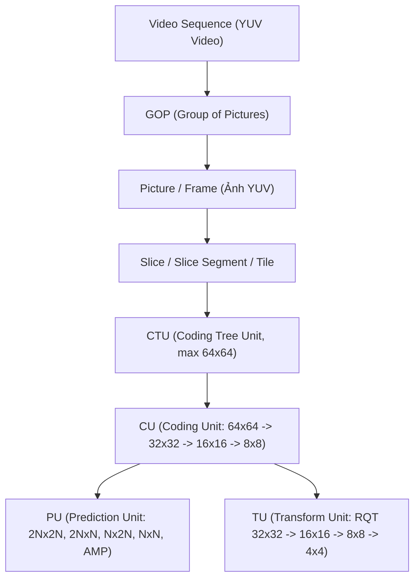
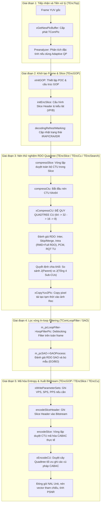

# KIẾN TRÚC ENCODER HEVC CHUẨN TRONG MÃ NGUỒN HM (HEVC TEST MODEL)

> Tài liệu phân tích toàn diện cấu trúc phân cấp, cơ chế tối ưu hóa tốc độ - méo dạng (RDO), và luồng xử lý chi tiết kèm cây gọi hàm (Call Stack Tree) từ mức Frame xuống mức CTU/CU/PU/TU trong mã nguồn phần mềm tham chiếu HEVC (**HM - HEVC Test Model**).

---

## MỤC LỤC
1. [Phân cấp dữ liệu chuẩn HEVC (Data Hierarchy)](#1-phân-cấp-dữ-liệu-chuẩn-hevc-data-hierarchy)
2. [Phân cấp kiến trúc Class C++ trong HM (Software Class Hierarchy)](#2-phân-cấp-kiến-trúc-class-c-trong-hm-software-class-hierarchy)
3. [Cơ chế RDO và Quản lý bộ đệm trạng thái](#3-cơ-chế-rdo-và-quản-lý-bộ-đệm-trạng-thái)
4. [Luồng xử lý End-to-End khi 1 Frame được đưa vào Encoder](#4-luồng-xử-lý-end-to-end-khi-1-frame-được-đưa-vào-encoder)
5. [Sơ đồ cây gọi hàm toàn diện (Complete Function Call Tree)](#5-sơ-đồ-cây-gọi-hàm-toàn-diện-complete-function-call-tree)
6. [Phân tích chi tiết giải thuật tại các hàm trọng yếu](#6-phân-tích-chi-tiết-giải-thuật-tại-các-hàm-trọng-yếu)
7. [Bảng ma trận thứ tự thực thi theo thời gian (Execution Matrix)](#7-bảng-ma-trận-thứ-tự-thực-thi-theo-thời-gian-execution-matrix)

---

## 1. Phân cấp dữ liệu chuẩn HEVC (Data Hierarchy)

HEVC tổ chức cấu trúc dữ liệu theo mô hình phân cấp đệ quy từ chuỗi video xuống khối biến đổi nhỏ nhất:



| Cấp bậc | Tên gọi | Kích thước phổ biến | Mô tả & Chức năng |
| :--- | :--- | :--- | :--- |
| **Sequence** | Chuỗi Video | Độ phân giải gốc | Tập hợp toàn bộ các frame video đầu vào. Được định nghĩa bởi tham số chuỗi VPS và SPS. |
| **GOP** | Group of Pictures | 1, 4, 8, hoặc 16 frame | Nhóm các frame được mã hóa cùng nhau theo cấu trúc phân cấp thời gian (Hierarchical-B hoặc Low-delay). |
| **Picture** | Khung hình | Width $\times$ Height | Một ảnh YUV hoàn chỉnh. Tương ứng với một chỉ số POC (Picture Order Count). |
| **Slice** | Lát cắt ảnh | Tập hợp các CTU | Đơn vị mã hóa độc lập trong frame, có thể giải mã riêng biệt. Gồm Slice Header và Slice Data. |
| **CTU** | Coding Tree Unit | $64\times64$ (mặc định) | Đơn vị mã hóa cơ sở lớn nhất, đóng vai trò là gốc của cây tứ phân (Quadtree). |
| **CU** | Coding Unit | $64\times64 \to 8\times8$ | Đơn vị quyết định chế độ mã hóa (Intra/Inter/Skip/PCM). Phân chia đệ quy 4 nhánh từ CTU. |
| **PU** | Prediction Unit | $64\times64 \to 4\times4$ | Đơn vị thực hiện dự đoán không gian (Intra) hoặc bù chuyển động (Inter). |
| **TU** | Transform Unit | $32\times32 \to 4\times4$ | Đơn vị biến đổi (DCT/DST) và lượng tử hóa sai số phần dư theo cây **RQT** (Residual Quadtree). |

---

## 2. Phân cấp kiến trúc Class C++ trong HM (Software Class Hierarchy)

Trong phần mềm HM, mã nguồn được phân chia thành hai thư viện chính:
* `TLibEncoder`: Chứa các lớp điều khiển mã hóa, tìm kiếm chuyển động, RDO, và sinh bitstream.
* `TLibCommon`: Chứa các cấu trúc dữ liệu ảnh (`TComPic`, `TComDataCU`), phép biến đổi (`TComTrQuant`), bộ lọc (`TComLoopFilter`), và hàm tính chi phí (`TComRdCost`).

| Lớp (Class) | Mức phân cấp | File Header / Source | Trách nhiệm chính |
| :--- | :--- | :--- | :--- |
| **`TAppEncTop`** | Ứng dụng (App Layer) | [TAppEncTop.h](file:///home/hoinguyen/Documents/Video_Compression/HEVC_reference_software/source/App/TAppEncoder/TAppEncTop.h)<br>[TAppEncTop.cpp](file:///home/hoinguyen/Documents/Video_Compression/HEVC_reference_software/source/App/TAppEncoder/TAppEncTop.cpp) | Đọc file cấu hình `.cfg`, đọc file video gốc `.yuv`, ghi file `.bin`/`.h265`, đo thời gian thực thi. |
| **`TEncTop`** | Encoder cấp cao (Top Engine) | [TEncTop.h](file:///home/hoinguyen/Documents/Video_Compression/HEVC_reference_software/source/Lib/TLibEncoder/TEncTop.h)<br>[TEncTop.cpp](file:///home/hoinguyen/Documents/Video_Compression/HEVC_reference_software/source/Lib/TLibEncoder/TEncTop.cpp) | Khởi tạo VPS/SPS/PPS, quản lý bể chứa frame (`m_cListPic`), tiền phân tích độ phức tạp (Pre-analyzer), điều khiển Rate Control. |
| **`TEncGOP`** | Quản lý GOP (GOP Layer) | [TEncGOP.h](file:///home/hoinguyen/Documents/Video_Compression/HEVC_reference_software/source/Lib/TLibEncoder/TEncGOP.h)<br>[TEncGOP.cpp](file:///home/hoinguyen/Documents/Video_Compression/HEVC_reference_software/source/Lib/TLibEncoder/TEncGOP.cpp) | Điều phối thứ tự POC của từng frame trong GOP, chạy lọc vòng DBF/SAO, đóng gói và xuất NAL units, tính PSNR. |
| **`TEncSlice`** | Quản lý Slice (Slice Layer) | [TEncSlice.h](file:///home/hoinguyen/Documents/Video_Compression/HEVC_reference_software/source/Lib/TLibEncoder/TEncSlice.h)<br>[TEncSlice.cpp](file:///home/hoinguyen/Documents/Video_Compression/HEVC_reference_software/source/Lib/TLibEncoder/TEncSlice.cpp) | Điều khiển vòng lặp duyệt toàn bộ CTU trong frame/slice theo thứ tự Raster Scan / WPP / Tiles. |
| **`TEncCu`** | Quản lý CTU / CU (CU Layer) | [TEncCu.h](file:///home/hoinguyen/Documents/Video_Compression/HEVC_reference_software/source/Lib/TLibEncoder/TEncCu.h)<br>[TEncCu.cpp](file:///home/hoinguyen/Documents/Video_Compression/HEVC_reference_software/source/Lib/TLibEncoder/TEncCu.cpp) | Đệ quy duyệt cây Quadtree CU (`xCompressCU`), điều phối các bước thử nghiệm RDO (Inter, Intra, Merge, Split), và duyệt cây mã hóa (`xEncodeCU`). |
| **`TEncSearch`** | Dự đoán & Tìm kiếm (PU/TU Layer) | [TEncSearch.h](file:///home/hoinguyen/Documents/Video_Compression/HEVC_reference_software/source/Lib/TLibEncoder/TEncSearch.h)<br>[TEncSearch.cpp](file:///home/hoinguyen/Documents/Video_Compression/HEVC_reference_software/source/Lib/TLibEncoder/TEncSearch.cpp) | Ước lượng chuyển động Inter (ME/AMVP/TZSearch/Sub-pel), đánh giá 35 mode Intra (RMD/MPM/Full RDO), tối ưu hóa cây biến đổi RQT (`xEstimateResidualQT`). |
| **`TComPrediction`** | Tạo tín hiệu dự đoán | [TComPrediction.h](file:///home/hoinguyen/Documents/Video_Compression/HEVC_reference_software/source/Lib/TLibCommon/TComPrediction.h)<br>[TComPrediction.cpp](file:///home/hoinguyen/Documents/Video_Compression/HEVC_reference_software/source/Lib/TLibCommon/TComPrediction.cpp) | Lọc mẫu tham chiếu, dự đoán hướng góc Intra (`predIntraAng`), nội suy phân số bù chuyển động 8-tap luma / 4-tap chroma (`motionCompensation`). |
| **`TComTrQuant`** | Biến đổi & Lượng tử hóa | [TComTrQuant.h](file:///home/hoinguyen/Documents/Video_Compression/HEVC_reference_software/source/Lib/TLibCommon/TComTrQuant.h)<br>[TComTrQuant.cpp](file:///home/hoinguyen/Documents/Video_Compression/HEVC_reference_software/source/Lib/TLibCommon/TComTrQuant.cpp) | Biến đổi thuận/nghịch DCT-II và 4x4 DST-VII, lượng tử hóa/giải lượng tử hóa, tối ưu lượng tử hóa dựa trên RD (RDOQ). |
| **`TComLoopFilter`** | Lọc khử khối biên (DBF) | [TComLoopFilter.h](file:///home/hoinguyen/Documents/Video_Compression/HEVC_reference_software/source/Lib/TLibCommon/TComLoopFilter.h)<br>[TComLoopFilter.cpp](file:///home/hoinguyen/Documents/Video_Compression/HEVC_reference_software/source/Lib/TLibCommon/TComLoopFilter.cpp) | Xác định cường độ biên Boundary Strength ($Bs \in \{0, 1, 2\}$) và thực hiện lọc khử hiệu ứng khối biên TU/PU trên toàn frame. |
| **`TEncSampleAdaptiveOffset`** | Bù mẫu thích ứng (SAO) | [TEncSampleAdaptiveOffset.h](file:///home/hoinguyen/Documents/Video_Compression/HEVC_reference_software/source/Lib/TLibEncoder/TEncSampleAdaptiveOffset.h)<br>[TEncSampleAdaptiveOffset.cpp](file:///home/hoinguyen/Documents/Video_Compression/HEVC_reference_software/source/Lib/TLibEncoder/TEncSampleAdaptiveOffset.cpp) | Thống kê phân phối mẫu biên (Edge Offset) và dải màu (Band Offset), tính RDO để chọn tham số SAO tối ưu cho từng CTU. |
| **`TEncSbac` / `TEncBinCABAC`** | Mã hóa Entropy CABAC | [TEncSbac.h](file:///home/hoinguyen/Documents/Video_Compression/HEVC_reference_software/source/Lib/TLibEncoder/TEncSbac.h)<br>[TEncSbac.cpp](file:///home/hoinguyen/Documents/Video_Compression/HEVC_reference_software/source/Lib/TLibEncoder/TEncSbac.cpp) | Mã hóa nhị phân thích ứng theo ngữ cảnh (CABAC), quản lý cập nhật xác suất và ước lượng số bit sinh ra phục vụ tính toán RD-Cost. |
| **`TComRdCost`** | Đánh giá Chi phí RD | [TComRdCost.h](file:///home/hoinguyen/Documents/Video_Compression/HEVC_reference_software/source/Lib/TLibCommon/TComRdCost.h)<br>[TComRdCost.cpp](file:///home/hoinguyen/Documents/Video_Compression/HEVC_reference_software/source/Lib/TLibCommon/TComRdCost.cpp) | Tính toán hàm mục tiêu Lagrange: $J = D + \lambda \cdot R$ và các độ đo sai khác SAD, SATD (Hadamard), SSE. |

---

## 3. Cơ chế RDO và Quản lý bộ đệm trạng thái

Quá trình nén HEVC là bài toán tối ưu hóa đa biến nhằm tìm ra tập mode phân vùng, hướng dự đoán, vector chuyển động và hệ số biến đổi có chi phí Lagrange nhỏ nhất:

$$J = D + \lambda \cdot R$$

Trong đó:
* $D$ (Distortion): Độ méo dạng giữa ảnh gốc và ảnh tái tạo (tính bằng SSE hoặc SAD/SATD).
* $R$ (Rate): Số bit cần thiết để mã hóa toàn bộ cú pháp (mode, MV, transform coefficients, cờ chia nhánh).
* $\lambda$ (Lagrange Multiplier): Hệ số phạt bit tương ứng với tham số lượng tử hóa QP.

### 3.1. Cơ chế đối sánh `rpcBestCU` và `rpcTempCU`
Tại mỗi độ sâu đệ quy `uiDepth` ($0 \le uiDepth \le 3$), `TEncCu` duy trì một cặp đối tượng CU:
1. **`rpcTempCU`**: Bộ đệm lưu kết quả thử nghiệm của chế độ hiện tại (ví dụ: đang thử nghiệm Inter 2Nx2N).
2. **`rpcBestCU`**: Bộ đệm lưu chế độ tốt nhất ghi nhận được cho đến thời điểm hiện tại.
3. **`xCheckBestMode()`**: Sau khi đánh giá xong một ứng viên, hàm này so sánh:
   $$\text{Nếu } J(\text{TempCU}) < J(\text{BestCU}) \implies \text{Copy toàn bộ dữ liệu từ TempCU sang BestCU}$$

### 3.2. Quản lý bối cảnh CABAC trong RDO
Mã hóa CABAC phụ thuộc chặt chẽ vào bảng xác suất ngữ cảnh (Context Models). Để đánh giá số bit $R$ chính xác cho từng mode mà không làm sai lệch bối cảnh mã hóa thực tế, HM thiết kế 3 vùng đệm trạng thái CABAC:
* **`CI_CURR_BEST`**: Trạng thái bối cảnh tại thời điểm bắt đầu xử lý khối CU hiện tại.
* **`CI_NEXT_BEST`**: Trạng thái bối cảnh tối ưu sau khi đã quyết định được mode tốt nhất cho CU.
* **`CI_TEMP_BEST`**: Trạng thái bối cảnh tạm thời trong lúc đang đánh giá một mode thử nghiệm.
* **`m_pcRDGoOnSbacCoder`**: Bộ đếm bit CABAC đặc biệt, liên tục nạp (`load`) và sao lưu (`store`) các bối cảnh để thử nghiệm các mode mà không ghi bit ra luồng dữ liệu thật.

---

## 4. Luồng xử lý End-to-End khi 1 Frame được đưa vào Encoder

Quá trình mã hóa một khung hình YUV trải qua **5 giai đoạn tuần tự**:



---

## 5. Sơ đồ cây gọi hàm toàn diện (Complete Function Call Tree)

Sơ đồ cây dưới đây thể hiện **chính xác cấu trúc lồng nhau (nesting)** và **thứ tự thời gian** của các hàm từ điểm vào `main()` xuống tận các hàm con sâu nhất:

```text
[encmain.cpp] main()
 └── [TAppEncTop.cpp] cTAppEncTop.encode()
      │
      ├── [Đọc YUV từ đĩa vào bộ đệm: pcPicYuvOrg]
      │
      └── [TEncTop.cpp] m_cTEncTop.encode(pcPicYuvOrg, ...)
           │
           ├── xGetNewPicBuffer() [Lấy đối tượng TComPic trống từ picture pool]
           ├── pcPicYuvOrg->copyToPic(pcPicCurr->getPicYuvOrg()) [Copy YUV gốc vào Pic]
           ├── m_cPreanalyzer.xPreanalyze() [Tiền phân tích phương sai luma nếu dùng Adaptive QP]
           │
           └── [TEncGOP.cpp] m_cGOPEncoder.compressGOP(..., rcListPic, ...)
                │
                ├── xInitGOP() [Khởi tạo danh sách tham chiếu POC cho GOP]
                │
                └── FOR EACH PICTURE TRONG GOP (iGOPid = 0 .. m_iGopSize - 1):
                     │
                     ├── xGetBuffer() [Lấy con trỏ pcPic tương ứng với pocCurr]
                     ├── m_pcSliceEncoder->initEncSlice() [Khởi tạo Slice, gán Slice Type: I/P/B]
                     ├── pcSlice->decodingRefreshMarking() [Cập nhật trạng thái IRAP / CRA / IDR]
                     │
                     │========================================================================
                     │ GIAI ĐOẠN 3: NÉN RDO THỬ NGHIỆM TỪNG SLICE & CTU (TRIAL COMPRESSION)
                     │========================================================================
                     ├── [TEncSlice.cpp] m_pcSliceEncoder->precompressSlice(pcPic) [Ước lượng QP/Lambda]
                     ├── [TEncSlice.cpp] m_pcSliceEncoder->compressSlice(pcPic, ...)
                     │    │
                     │    ├── xDetermineStartAndBoundingCtuTsAddr() [Xác định phạm vi địa chỉ CTU của slice]
                     │    ├── xEstimateWPParamSlice() [Ước lượng tham số Weighted Prediction nếu bật]
                     │    │
                     │    └── FOR EACH CTU IN SLICE (ctuTsAddr = startCtuTsAddr .. boundingCtuTsAddr - 1):
                     │         │
                     │         ├── [TEncCu.cpp] m_pcCuEncoder->compressCtu(pCtu)
                     │         │    │
                     │         │    └── m_pcCuEncoder->xCompressCU(rpcBestCU, rpcTempCU, uiDepth = 0)
                     │         │         │   [=== BẮT ĐẦU ĐỆ QUY TỪNG CU TẠI ĐỘ SÂU uiDepth ===]
                     │         │         │
                     │         │         ├── [1] THỬ CÁC CHẾ ĐỘ DỰ ĐOÁN INTER (Nếu không phải I-Slice):
                     │         │         │    │
                     │         │         │    ├── xCheckRDCostMerge2Nx2N() [Thử chế độ Merge / Skip]
                     │         │         │    │    ├── [TComPrediction.cpp] motionCompensation() [Bù chuyển động]
                     │         │         │    │    ├── [TEncSearch.cpp] encodeResAndCalcRdInterCU() [Tính RQT & RD-Cost]
                     │         │         │    │    └── xCheckBestMode() [Cập nhật rpcBestCU nếu RD-Cost nhỏ hơn]
                     │         │         │    │
                     │         │         │    ├── xCheckRDCostInter(SIZE_2Nx2N) [Inter thông thường 2Nx2N]
                     │         │         │    │    ├── [TEncSearch.cpp] predInterSearch()
                     │         │         │    │    │    ├── xEstimateMvPredAMVP() [Lấy và chọn ứng viên AMVP tốt nhất]
                     │         │         │    │    │    ├── xMotionEstimation() [Tìm kiếm vector MV nguyên bằng TZSearch]
                     │         │         │    │    │    ├── xPatternSearchFrac() [Tinh chỉnh MV phân số: 1/2 và 1/4 pel]
                     │         │         │    │    │    └── xEstimateBiPred() [Đánh giá dự đoán 2 chiều List 0 + List 1]
                     │         │         │    │    ├── [TEncSearch.cpp] encodeResAndCalcRdInterCU()
                     │         │         │    │    │    └── xEstimateResidualQT() [Tìm kiếm cây TU tối ưu - RQT]
                     │         │         │    │    │         ├── [TComTrQuant.cpp] transformNxN() [Biến đổi DCT/DST]
                     │         │         │    │    │         ├── [TComTrQuant.cpp] quant() [Lượng tử hóa + RDOQ]
                     │         │         │    │    │         ├── [TComTrQuant.cpp] invQuant() & invTransformNxN()
                     │         │         │    │    │         └── [TComRdCost.cpp] calcRdCost() [Tính J = D + lambda*R]
                     │         │         │    │    └── xCheckBestMode()
                     │         │         │    │
                     │         │         │    ├── xCheckRDCostInter(SIZE_2NxN, SIZE_Nx2N) [Chia phân vùng đối xứng]
                     │         │         │    │    └── (Các bước tìm kiếm ME và RQT tương tự như trên)
                     │         │         │    │
                     │         │         │    └── xCheckRDCostInter(SIZE_2NxnU, 2NxnD, nLx2N, nRx2N) [AMP - nếu bật]
                     │         │         │         └── (Các bước tìm kiếm ME và RQT tương tự như trên)
                     │         │         │
                     │         │         ├── [2] THỬ CÁC CHẾ ĐỘ DỰ ĐOÁN INTRA:
                     │         │         │    │
                     │         │         │    ├── xCheckRDCostIntra(SIZE_2Nx2N)
                     │         │         │    │    ├── [TEncSearch.cpp] estIntraPredLumaQT()
                     │         │         │    │    │    ├── initIntraPatternChType() [Lọc mẫu biên tham chiếu luma]
                     │         │         │    │    │    ├── FOR EACH OF 35 INTRA MODES: [Rough Mode Decision - RMD]
                     │         │         │    │    │    │    ├── [TComPrediction.cpp] predIntraAng() [Tạo mẫu dự đoán hướng]
                     │         │         │    │    │    │    └── distParam.DistFunc() [Tính Hadamard SATD + mode bits]
                     │         │         │    │    │    ├── Lập danh sách ứng viên nhỏ + bổ sung 3 chế độ MPM
                     │         │         │    │    │    └── FOR EACH CANDIDATE MODE: [Full RDO Phase]
                     │         │         │    │    │         └── xRecurIntraCodingLumaQT() [Đệ quy kiểm tra chia TU]
                     │         │         │    │    │              ├── predIntraAng()
                     │         │         │    │    │              ├── [TComTrQuant.cpp] transformNxN() & quant()
                     │         │         │    │    │              ├── invTransformNxN() & invQuant()
                     │         │         │    │    │              └── calcRdCost()
                     │         │         │    │    ├── [TEncSearch.cpp] estIntraPredChromaQT() [Tìm mode tốt nhất cho Chroma]
                     │         │         │    │    └── xCheckBestMode()
                     │         │         │    │
                     │         │         │    └── xCheckRDCostIntra(SIZE_NxN) [Chỉ thử ở độ sâu tối đa (CU 8x8)]
                     │         │         │
                     │         │         ├── [3] THỬ CHẾ ĐỘ PCM (Lossless raw samples):
                     │         │         │    └── xCheckIntraPCM()
                     │         │         │
                     │         │         ├── [4] ĐỆ QUY CHIA CU THÀNH 4 SUB-CU (QUADTREE SPLIT):
                     │         │         │    │
                     │         │         │    ├── IF (uiDepth < MaxDepth):
                     │         │         │    │    FOR uiPartUnitIdx = 0 .. 3:
                     │         │         │    │         └── xCompressCU(pcSubBestCU, pcSubTempCU, uiDepth + 1) [ĐỆ QUY]
                     │         │         │    │
                     │         │         │    ├── encodeSplitFlag() [Tính số bit mã hóa cờ split_flag]
                     │         │         │    └── xCheckBestMode() [So sánh chi phí J(Parent) vs J(Tổng 4 Sub-CUs)]
                     │         │         │
                     │         │         ├── rpcBestCU->copyToPic(uiDepth) [Ghi thông tin CU tối ưu nhất vào Frame]
                     │         │         └── xCopyYuv2Pic() [Copy pixel tái tạo YUV của CU vào Picture YUV]
                     │         │
                     │         └── [TEncCu.cpp] m_pcCuEncoder->encodeCtu(pCtu)
                     │              └── xEncodeCU(pCtu, 0, 0) [Chạy mã hóa entropy nháp để cập nhật CABAC model & đếm bit]
                     │
                     │========================================================================
                     │ GIAI ĐOẠN 4: IN-LOOP FILTERING (LỌC VÒNG TRÊN ẢNH TÁI TẠO)
                     │========================================================================
                     ├── [TComLoopFilter.cpp] m_pcLoopFilter->loopFilterPic(pcPic) [Deblocking Filter]
                     │    ├── Duyệt toàn bộ các ranh giới khối cạnh ngang và cạnh dọc (PU và TU)
                     │    ├── Tính chỉ số cường độ biên Boundary Strength (Bs = 0, 1, 2)
                     │    └── Thực hiện lọc làm mịn các mẫu điểm biên luma và chroma
                     │
                     ├── [TEncSampleAdaptiveOffset.cpp] m_pcSAO->SAOProcess(pcPic, ...) [Sample Adaptive Offset]
                     │    ├── Thu thập thống kê biên và dải màu (EO - Edge Offset, BO - Band Offset)
                     │    ├── Tính RDO chọn mode SAO tối ưu cho từng CTU (None / New / Merge Left / Merge Up)
                     │    └── Cộng các giá trị bù offset vào khung hình tái tạo
                     │
                     │========================================================================
                     │ GIAI ĐOẠN 5: MÃ HÓA ENTROPY CHÍNH THỨC & XUẤT BITSTREAM NAL UNITS
                     │========================================================================
                     ├── xWriteParameterSets() [Ghi NAL Units: VPS, SPS, PPS nếu là frame IRAP/IDR]
                     ├── xCreatePerPictureSEIMessages() [Tạo các thông điệp SEI phụ trợ]
                     ├── m_pcEntropyCoder->encodeSliceHeader(pcSlice) [Ghi Slice Header vào Bitstream]
                     │
                     ├── [TEncSlice.cpp] m_pcSliceEncoder->encodeSlice(pcPic, &substreamsOut, ...)
                     │    │
                     │    └── FOR EACH CTU IN SLICE:
                     │         │
                     │         ├── m_pcEntropyCoder->encodeSAOBlkParam() [Ghi các tham số bù mẫu SAO của CTU]
                     │         │
                     │         └── [TEncCu.cpp] m_pcCuEncoder->encodeCtu(pCtu)
                     │              └── xEncodeCU(pcCU, uiAbsPartIdx = 0, uiDepth = 0) [DUYỆT CÂY QUADTREE THẬT]
                     │                   │
                     │                   ├── encodeSplitFlag() [Ghi cờ chia tách CU]
                     │                   │
                     │                   ├── IF (CU bị chia):
                     │                   │    └── FOR 4 sub-CUs: xEncodeCU(..., uiDepth + 1)
                     │                   │
                     │                   └── IF (CU là lá - Leaf CU, không chia nữa):
                     │                        ├── encodeCUTransquantBypassFlag()
                     │                        ├── encodeSkipFlag()
                     │                        ├── IF (Skip mode == true):
                     │                        │    ├── encodeMergeIndex() [Chỉ ghi chỉ số ứng viên Merge]
                     │                        │    └── finishCU() -> RETURN
                     │                        ├── encodePredMode() [Ghi MODE_INTER hoặc MODE_INTRA]
                     │                        ├── encodePartSize() [Ghi kích thước phân vùng PU]
                     │                        ├── encodePredInfo() [Ghi hướng Intra hoặc Vector MV/RefIdx]
                     │                        ├── encodeCoeff() [Ghi cây biến đổi TU: cbf, sig_coeff_map, coeff_abs]
                     │                        └── finishCU() [Ghi bit kết thúc CU]
                     │
                     ├── xAttachSliceDataToNalUnit() [Nối bitstream dữ liệu slice vào NALUnit hoàn chỉnh]
                     ├── accessUnit.push_back(NALUnit)
                     ├── pcPic->compressMotion() [Nén vector chuyển động để lưu trữ trong DPB tham chiếu]
                     ├── xCalculateAddPSNRs() [So sánh ảnh tái tạo với ảnh gốc để tính PSNR Y/U/V và in terminal]
                     └── xWriteTrailingSEIMessages()
```

---

## 6. Phân tích chi tiết giải thuật tại các hàm trọng yếu

### 6.1. `TEncCu::xCompressCU()`
Hàm trung tâm điều khiển đệ quy Quadtree và tối ưu hóa RDO. Các bước thực thi tuần tự tại mỗi độ sâu `uiDepth`:
1. **Lấy mẫu gốc YUV**: Gọi `m_ppcOrigYuv[uiDepth]->copyFromPicYuv()`.
2. **Thử nghiệm Inter (nếu là P/B Slice)**:
   * **Merge / Skip**: Gọi `xCheckRDCostMerge2Nx2N()`. Nếu khối thỏa mãn `QtRootCbf == 0` (không có phần dư) và bật `EarlySkipDetection`, encoder có thể bỏ qua các phép thử Inter tốn kém phía sau.
   * **Inter 2Nx2N**: Gọi `xCheckRDCostInter(SIZE_2Nx2N)`.
   * **Inter Partitions**: Gọi `xCheckRDCostInter()` cho các phân vùng đối xứng ($2N\times N, N\times2N$) và bất đối xứng AMP ($2N\times nU, 2N\times nD, nL\times2N, nR\times2N$).
3. **Thử nghiệm Intra**:
   * Gọi `xCheckRDCostIntra(SIZE_2Nx2N)`.
   * Nếu ở độ sâu tối đa ($8\times8$), thử thêm `xCheckRDCostIntra(SIZE_NxN)`.
4. **Thử nghiệm PCM**: Gọi `xCheckIntraPCM()` nếu kích thước khối nằm trong giới hạn cấu hình PCM.
5. **Đệ quy Quadtree Split**:
   * Nếu chưa đạt độ sâu cực đại và không bị dừng sớm bởi `EarlyCU`, khởi tạo 4 sub-CU (`uiDepth + 1`).
   * Gọi đệ quy `xCompressCU()` cho từng sub-CU trong vòng lặp `for (uiPartUnitIdx = 0; uiPartUnitIdx < 4; uiPartUnitIdx++)`.
   * Cộng dồn chi phí của 4 sub-CU và số bit của cờ `split_flag`.
6. **Quyết định tối ưu cuối cùng**:
   * Gọi `xCheckBestMode()` so sánh $J_{Parent}$ và $J_{4 \times SubCU}$.
   * Copy kết quả tốt nhất vào `rpcBestCU` và gọi `xCopyYuv2Pic()` để lưu mẫu ảnh tái tạo.

### 6.2. `TEncSearch::estIntraPredLumaQT()`
Đánh giá 35 chế độ dự đoán Intra (Chế độ 0: Planar, Chế độ 1: DC, Chế độ 2-34: Hướng góc Angular):
1. **Rough Mode Decision (RMD)**:
   * Chạy vòng lặp qua toàn bộ 35 chế độ.
   * Tính mẫu dự đoán bằng `predIntraAng()`.
   * Tính chi phí gần đúng bằng biến đổi Hadamard nhanh (SATD) cộng với số bit ước lượng của mode:
     $$Cost_{RMD} = SATD + \lambda_{Had} \cdot R_{mode}$$
   * Chọn ra một danh sách ngắn gồm 3 hoặc 8 ứng viên có chi phí $Cost_{RMD}$ thấp nhất (tùy kích thước khối).
2. **Bổ sung Most Probable Modes (MPM)**:
   * Xác định 3 chế độ MPM dựa trên hướng dự đoán của hai khối lân cận bên trái ($A$) và bên trên ($B$).
   * Nếu các chế độ MPM chưa nằm trong danh sách ngắn, đưa chúng vào danh sách để đánh giá đầy đủ.
3. **Full RDO Search**:
   * Duyệt qua từng ứng viên trong danh sách.
   * Gọi `xRecurIntraCodingLumaQT()` để thực hiện đầy đủ quy trình: Dự đoán $\to$ Trừ mẫu gốc tìm phần dư $\to$ Biến đổi DCT/DST $\to$ Lượng tử hóa $\to$ Giải lượng tử & Biến đổi ngược $\to$ Tái tạo $\to$ Ước lượng bit CABAC $\to$ Tính RD-Cost chính xác theo SSE.
   * Chọn ra chế độ có $J = SSE + \lambda \cdot R$ nhỏ nhất.

### 6.3. `TEncSearch::predInterSearch()`
Thực hiện ước lượng chuyển động (Motion Estimation - ME) cho khối Inter:
1. **AMVP Candidate Selection**:
   * Lấy danh sách 2 ứng viên MV từ các khối lân cận không gian và thời gian (`fillMvpCand`).
   * Gọi `xEstimateMvPredAMVP()` để chọn ra vector dự đoán ban đầu (MVP) cho chi phí nhỏ nhất.
2. **Integer Motion Estimation (IME)**:
   * Gọi `xMotionEstimation()`.
   * Sử dụng thuật toán tìm kiếm nhanh hình hoa kim cương **TZSearch** (Test Zone Search) với các bước mở rộng từ tâm tìm kiếm (Search Center) để tìm vector chuyển động nguyên pixel tối ưu nhất theo tiêu chí SAD/SATD.
3. **Fractional Motion Estimation (FME)**:
   * Gọi `xPatternSearchFrac()` để tinh chỉnh vector chuyển động ở độ chính xác nửa mẫu (Half-pel) và một phần tư mẫu (Quarter-pel).
   * Sử dụng bộ lọc nội suy 8-tap luma để sinh mẫu ảnh phân số và đánh giá sai số.
4. **Bi-prediction Evaluation**:
   * Nếu là B-slice, gọi `xEstimateBiPred()` để đánh giá kết hợp dự đoán hai chiều từ cả hai danh sách List 0 và List 1.

### 6.4. `TEncSearch::encodeResAndCalcRdInterCU()` & `xEstimateResidualQT()`
Tối ưu hóa cây biến đổi phần dư (**RQT** - Residual Quadtree):
1. Tính ma trận sai số phần dư: $Residual = Org - Pred$.
2. Đánh giá chia đệ quy cây TU (tối đa từ $32\times32$ xuống $4\times4$).
3. Tại mỗi nút TU:
   * Gọi `m_pcTrQuant->transformNxN()` để biến đổi phần dư sang miền tần số.
   * Gọi `m_pcTrQuant->quant()` để lượng tử hóa và chạy thuật toán **RDOQ** (Rate-Distortion Optimized Quantization) nhằm làm tròn các hệ số biến đổi tối ưu theo RD.
   * Tính toán cờ CBF (Coded Block Flag) và chi phí nếu dừng lại tại độ sâu TU này so với chi phí nếu tiếp tục chia TU thành 4 khối con.
   * Chọn cấu trúc phân chia TU có tổng chi phí nhỏ nhất.

### 6.5. In-loop Filtering: Deblocking Filter & SAO
1. **Deblocking Filter (`TComLoopFilter::loopFilterPic`)**:
   * Được áp dụng độc lập trên các biên khối $8\times8$.
   * Tính toán Boundary Strength ($Bs$):
     * $Bs = 2$: Biên giữa các khối Intra.
     * $Bs = 1$: Biên giữa các khối Inter có chứa hệ số biến đổi hoặc chênh lệch vector chuyển động $|MV| \ge 1$ sample.
     * $Bs = 0$: Biên không có sự khác biệt chuyển động và không có hệ số biến đổi.
   * Áp dụng bộ lọc mạnh (Strong filter) hoặc bộ lọc yếu (Weak filter) dựa trên ngưỡng chênh lệch mẫu biên $\beta$ và $t_C$.
2. **Sample Adaptive Offset (`TEncSampleAdaptiveOffset::SAOProcess`)**:
   * Chạy sau khi Deblocking Filter hoàn tất.
   * **Edge Offset (EO)**: Phân loại từng mẫu điểm theo 4 hướng dải biên ($0^\circ, 90^\circ, 135^\circ, 45^\circ$) và xác định thuộc tính cực tiểu địa phương/cực đại địa phương (Category 1-4) để bù giá trị offset.
   * **Band Offset (BO)**: Chia dải giá trị độ sáng 256 mức thành 32 dải (bands), chọn ra 4 dải liên tiếp có sai số lớn nhất để cộng offset.
   * Sử dụng RDO để quyết định chọn chế độ SAO cho từng CTU (Tắt SAO, Bật SAO mới, hoặc Kế thừa tham số Merge từ CTU bên trái/bên trên).

---

## 7. Bảng ma trận thứ tự thực thi theo thời gian (Execution Matrix)

Bảng dưới đây liệt kê thứ tự tuần tự tuyệt đối của toàn bộ các hàm cốt lõi trong chu trình mã hóa 1 frame:

| Thứ tự | Tên hàm gọi | Lớp (Class) | File nguồn | Vai trò kỹ thuật chi tiết |
| :---: | :--- | :--- | :--- | :--- |
| **1** | `cTAppEncTop.encode()` | `TAppEncTop` | [TAppEncTop.cpp](file:///home/hoinguyen/Documents/Video_Compression/HEVC_reference_software/source/App/TAppEncoder/TAppEncTop.cpp) | Vòng lặp chính đọc file video YUV và kích hoạt encoder. |
| **2** | `m_cTEncTop.encode()` | `TEncTop` | [TEncTop.cpp](file:///home/hoinguyen/Documents/Video_Compression/HEVC_reference_software/source/Lib/TLibEncoder/TEncTop.cpp) | Nạp dữ liệu ảnh vào `TComPic`, quản lý GOP và Pre-analysis. |
| **3** | `m_cGOPEncoder.compressGOP()` | `TEncGOP` | [TEncGOP.cpp](file:///home/hoinguyen/Documents/Video_Compression/HEVC_reference_software/source/Lib/TLibEncoder/TEncGOP.cpp) | Vòng lặp điều phối nén toàn bộ các frame trong 1 GOP theo POC. |
| **4** | `m_pcSliceEncoder->compressSlice()` | `TEncSlice` | [TEncSlice.cpp](file:///home/hoinguyen/Documents/Video_Compression/HEVC_reference_software/source/Lib/TLibEncoder/TEncSlice.cpp) | Vòng lặp duyệt các CTU trong slice để thực hiện nén thử nghiệm RDO. |
| **5** | `m_pcCuEncoder->compressCtu()` | `TEncCu` | [TEncCu.cpp](file:///home/hoinguyen/Documents/Video_Compression/HEVC_reference_software/source/Lib/TLibEncoder/TEncCu.cpp) | Khởi tạo cấu trúc đệm CTU $64\times64$ cho phân tích RDO. |
| **6** | `xCompressCU()` | `TEncCu` | [TEncCu.cpp](file:///home/hoinguyen/Documents/Video_Compression/HEVC_reference_software/source/Lib/TLibEncoder/TEncCu.cpp) | **Đệ quy Quadtree**, đánh giá toàn diện các mode để tìm cấu hình RD cực tiểu. |
| **7** | `xCheckRDCostMerge2Nx2N()` | `TEncCu` | [TEncCu.cpp](file:///home/hoinguyen/Documents/Video_Compression/HEVC_reference_software/source/Lib/TLibEncoder/TEncCu.cpp) | Thử nghiệm chế độ Merge và Skip dựa trên ứng viên không gian/thời gian. |
| **8** | `predInterSearch()` | `TEncSearch` | [TEncSearch.cpp](file:///home/hoinguyen/Documents/Video_Compression/HEVC_reference_software/source/Lib/TLibEncoder/TEncSearch.cpp) | Thực hiện ước lượng chuyển động Inter (AMVP, TZSearch, Sub-pel, Bi-pred). |
| **9** | `estIntraPredLumaQT()` | `TEncSearch` | [TEncSearch.cpp](file:///home/hoinguyen/Documents/Video_Compression/HEVC_reference_software/source/Lib/TLibEncoder/TEncSearch.cpp) | Dự đoán Intra luma qua 2 pha: Lọc nhanh RMD $\to$ Full RDO trên MPM. |
| **10**| `encodeResAndCalcRdInterCU()` | `TEncSearch` | [TEncSearch.cpp](file:///home/hoinguyen/Documents/Video_Compression/HEVC_reference_software/source/Lib/TLibEncoder/TEncSearch.cpp) | Biến đổi, lượng tử hóa và đệ quy tìm kiếm cây biến đổi phần dư RQT. |
| **11**| `xCheckBestMode()` | `TEncCu` | [TEncCu.cpp](file:///home/hoinguyen/Documents/Video_Compression/HEVC_reference_software/source/Lib/TLibEncoder/TEncCu.cpp) | So sánh chi phí $J_{Temp}$ và $J_{Best}$ để cập nhật mode chiến thắng. |
| **12**| `m_pcLoopFilter->loopFilterPic()`| `TComLoopFilter`| [TComLoopFilter.cpp](file:///home/hoinguyen/Documents/Video_Compression/HEVC_reference_software/source/Lib/TLibCommon/TComLoopFilter.cpp) | Khử khối biên (Deblocking) trên toàn bộ khung hình tái tạo. |
| **13**| `m_pcSAO->SAOProcess()` | `TEncSampleAdaptiveOffset`| [TEncSampleAdaptiveOffset.cpp](file:///home/hoinguyen/Documents/Video_Compression/HEVC_reference_software/source/Lib/TLibEncoder/TEncSampleAdaptiveOffset.cpp) | Tính toán tham số SAO tối ưu cho từng CTU và bù mẫu thích ứng. |
| **14**| `m_pcSliceEncoder->encodeSlice()`| `TEncSlice` | [TEncSlice.cpp](file:///home/hoinguyen/Documents/Video_Compression/HEVC_reference_software/source/Lib/TLibEncoder/TEncSlice.cpp) | Vòng lặp duyệt các CTU để mã hóa cú pháp CABAC thực tế xuống bitstream. |
| **15**| `xEncodeCU()` | `TEncCu` | [TEncCu.cpp](file:///home/hoinguyen/Documents/Video_Compression/HEVC_reference_software/source/Lib/TLibEncoder/TEncCu.cpp) | Duyệt cây Quadtree tối ưu và viết các phần tử cú pháp vào CABAC. |
| **16**| `xCalculateAddPSNRs()` | `TEncGOP` | [TEncGOP.cpp](file:///home/hoinguyen/Documents/Video_Compression/HEVC_reference_software/source/Lib/TLibEncoder/TEncGOP.cpp) | So sánh khung hình tái tạo với khung hình gốc để tính PSNR (Y, U, V). |