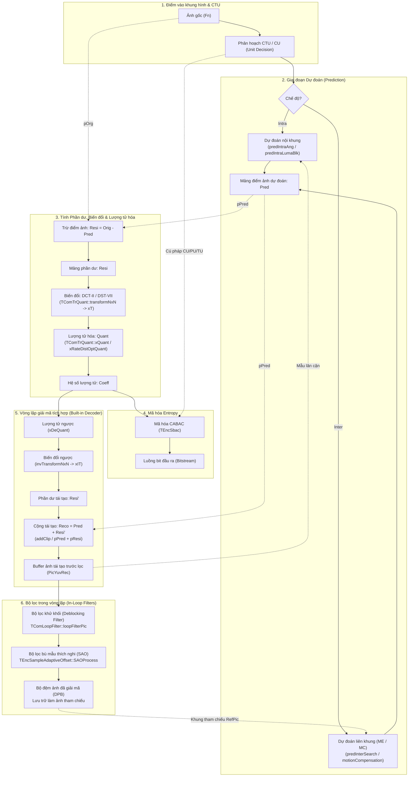

# 02. Phân Tích Luồng Mã Hóa Xử Lý Theo Khối (Block-Based Hybrid Encoding) trong HM

> [!NOTE]
> Tài liệu kỹ thuật chi tiết về mô hình mã hóa lai ghép dựa trên khối (**Block-based Hybrid Video Coding**) theo chuẩn ITU-T H.265 / HEVC và cách hiện thực hóa trong mã nguồn tham chiếu **HM Reference Software** (thư viện [`TLibCommon`](file:///home/hoinguyen/Documents/Video_Compression/HEVC_reference_software/source/Lib/TLibCommon) và [`TLibEncoder`](file:///home/hoinguyen/Documents/Video_Compression/HEVC_reference_software/source/Lib/TLibEncoder)).

---

## 📑 Mục lục
1. [Sơ đồ khối tổng quan HEVC Hybrid Encoder (Fig 3.1)](#1-sơ-đồ-khối-tổng-quan-hevc-hybrid-encoder-fig-31)
2. [Trace (Truy vết) dòng chảy dữ liệu điểm ảnh mảng 2D](#2-trace-truy-vết-dòng-chảy-dữ-liệu-điểm-ảnh-mảng-2d)
   - [2.1. Khâu Dự đoán (Prediction)](#21-khâu-dự-đoán-prediction)
   - [2.2. Tính Phần dư (Residual), Biến đổi & Lượng tử hóa](#22-tính-phần-dư-residual-biến-đổi--lượng-tử-hóa)
   - [2.3. Vòng lặp giải mã tích hợp (Built-in In-Loop Decoder)](#23-vòng-lặp-giải-mã-tích-hợp-built-in-in-loop-decoder)
   - [2.4. Các bộ lọc trong vòng lặp (In-Loop Filters)](#24-các-bộ-lọc-trong-vòng-lặp-in-loop-filters)
3. [Bảng đối chiếu: Xử lý điểm ảnh thuần túy (Block) vs Cú pháp điều khiển (Unit)](#3-bảng-đối-chiếu-xử-lý-điểm-ảnh-thuần-túy-block-vs-cú-pháp-điều-khiển-unit)
4. [Tóm tắt 3 nguyên lý cốt lõi](#4-tóm-tắt-3-nguyên-lý-cốt-lõi)

---

## 1. Sơ đồ khối tổng quan HEVC Hybrid Encoder (Fig 3.1)

Mô hình mã hóa lai ghép kết hợp giữa **Dự đoán không gian/thời gian (Intra/Inter)**, **Biến đổi & Lượng tử hóa (Transform & Quantization)**, **Mã hóa Entropy (CABAC)** và một **Bộ giải mã tích hợp trong vòng lặp (Built-in In-Loop Decoder)**:



---

## 2. Trace (Truy vết) dòng chảy dữ liệu điểm ảnh mảng 2D

### 2.1. Khâu Dự đoán (Prediction)

#### A. Dự đoán nội khung (Intra Prediction)
* **Vị trí gọi trong HM:** [`TEncSearch::estIntraPredLumaQT()`](file:///home/hoinguyen/Documents/Video_Compression/HEVC_reference_software/source/Lib/TLibEncoder/TEncSearch.cpp#L2204) và [`TEncSearch::xIntraCodingTUBlock()`](file:///home/hoinguyen/Documents/Video_Compression/HEVC_reference_software/source/Lib/TLibEncoder/TEncSearch.cpp#L1130).
* **Hàm sinh điểm ảnh dự đoán:** [`TComPrediction::predIntraAng()`](file:///home/hoinguyen/Documents/Video_Compression/HEVC_reference_software/source/Lib/TLibCommon/TComPrediction.cpp#L390).
* **Quy trình xử lý điểm ảnh mảng 2D:**
  1. **Lấy mẫu biên tái tạo:** Đọc $4N+1$ mẫu điểm ảnh lân cận (Above và Left) từ bộ đệm ảnh tái tạo [`pcCU->getPic()->getPicYuvRec()`](file:///home/hoinguyen/Documents/Video_Compression/HEVC_reference_software/source/Lib/TLibEncoder/TEncSearch.cpp#L1170).
  2. **Lọc mẫu tham chiếu (MDIS):** Áp dụng bộ lọc 3-tap $[1, 2, 1]/4$ hoặc Strong Intra Smoothing để làm mịn mẫu biên thông qua `initIntraPatternChType()`.
  3. **Nội suy góc hướng:** Dựa trên mode được chọn (`uiChFinalMode` từ 0 đến 34: Planar, DC, hoặc 33 hướng Angular), hàm tính toán các giá trị pixel dự đoán và ghi trực tiếp vào mảng con trỏ 2D:
     ```cpp
     Pel* piPred = pcPredYuv->getAddr( compID, uiAbsPartIdx ); // Bước nhảy dòng: uiStride
     ```

#### B. Dự đoán liên khung (Inter Prediction)
* **Vị trí gọi trong HM:** [`TEncSearch::predInterSearch()`](file:///home/hoinguyen/Documents/Video_Compression/HEVC_reference_software/source/Lib/TLibEncoder/TEncSearch.cpp#L3057).
* **Quy trình xử lý điểm ảnh:**
  1. Duyệt qua từng phân vùng dự đoán (PB) bằng biến `iPartIdx` ([dòng 3120](file:///home/hoinguyen/Documents/Video_Compression/HEVC_reference_software/source/Lib/TLibEncoder/TEncSearch.cpp#L3120)).
  2. **Ước lượng chuyển động (Motion Estimation):** Hàm [`xMotionEstimation()`](file:///home/hoinguyen/Documents/Video_Compression/HEVC_reference_software/source/Lib/TLibEncoder/TEncSearch.cpp#L3300) tìm kiếm vector chuyển động tối ưu $MV = (dx, dy)$ trên khung hình tham chiếu trong DPB.
  3. **Bù chuyển động (Motion Compensation):** Tại [dòng 3555](file:///home/hoinguyen/Documents/Video_Compression/HEVC_reference_software/source/Lib/TLibEncoder/TEncSearch.cpp#L3555), gọi:
     ```cpp
     motionCompensation( pcCU, pcPredYuv, REF_PIC_LIST_X, iPartIdx );
     ```
     Hàm [`TComPrediction::motionCompensation()`](file:///home/hoinguyen/Documents/Video_Compression/HEVC_reference_software/source/Lib/TLibCommon/TComPrediction.cpp#L905) sử dụng bộ lọc nội suy phân số 8-tap (với Luma) và 4-tap (với Chroma) để tạo mảng pixel dự đoán kích thước $W \times H$ tại con trỏ `pcPredYuv`.

---

### 2.2. Tính Phần dư (Residual), Biến đổi & Lượng tử hóa

#### A. Tính mảng phần dư (Residual Subtraction)
Tại cấp độ Transform Block (TB) trong [`TEncSearch::xIntraCodingTUBlock()`](file:///home/hoinguyen/Documents/Video_Compression/HEVC_reference_software/source/Lib/TLibEncoder/TEncSearch.cpp#L1252-L1262) (cho Intra) hoặc [`xEstimateInterResidualQT()`](file:///home/hoinguyen/Documents/Video_Compression/HEVC_reference_software/source/Lib/TLibEncoder/TEncSearch.cpp#L4870) (cho Inter), diễn ra phép trừ ma trận điểm ảnh:
```cpp
Pel* pOrg  = piOrg;   // Điểm ảnh mảng gốc 2D (Original)
Pel* pPred = piPred;  // Điểm ảnh mảng dự đoán 2D (Prediction)
Pel* pResi = piResi;  // Điểm ảnh mảng phần dư 2D (Residual)

for( UInt uiY = 0; uiY < uiHeight; uiY++ ) {
  for( UInt uiX = 0; uiX < uiWidth; uiX++ ) {
    pResi[ uiX ] = pOrg[ uiX ] - pPred[ uiX ]; // Resi = Orig - Pred
  }
  pOrg  += uiStride;
  pPred += uiStride;
  pResi += uiStride;
}
```

#### B. Biến đổi thuận (Forward Transform)
* **Vị trí gọi:** [`TComTrQuant::transformNxN()`](file:///home/hoinguyen/Documents/Video_Compression/HEVC_reference_software/source/Lib/TLibCommon/TComTrQuant.cpp#L1452).
* **Cơ chế:**
  1. Kiểm tra cờ `TransformSkip`: Nếu bật, chỉ dịch tỉ lệ mà không biến đổi qua [`xTransformSkip()`](file:///home/hoinguyen/Documents/Video_Compression/HEVC_reference_software/source/Lib/TLibCommon/TComTrQuant.cpp#L1507).
  2. Nếu không bỏ qua biến đổi: Gọi hàm nhân ma trận biến đổi [`TComTrQuant::xT()`](file:///home/hoinguyen/Documents/Video_Compression/HEVC_reference_software/source/Lib/TLibCommon/TComTrQuant.cpp#L1512):
     * Khối Luma $4 \times 4$ trong Intra: Áp dụng biến đổi số nguyên **DST-VII** 4x4.
     * Tất cả các kích thước còn lại ($4\times 4$ Inter, $8\times 8, 16\times 16, 32\times 32$): Áp dụng biến đổi số nguyên **DCT-II**.
  3. Kết quả là mảng 2D các hệ số phổ tần số nguyên `m_plTempCoeff`.

#### C. Lượng tử hóa thuận (Forward Quantization)
* **Vị trí gọi:** [`TComTrQuant::xQuant()`](file:///home/hoinguyen/Documents/Video_Compression/HEVC_reference_software/source/Lib/TLibCommon/TComTrQuant.cpp#L1520) hoặc [`TComTrQuant::xRateDistOptQuant()`](file:///home/hoinguyen/Documents/Video_Compression/HEVC_reference_software/source/Lib/TLibCommon/TComTrQuant.cpp#L789) (nếu bật RDOQ).
* **Cơ chế toán học:**
  $$\text{Level} = \text{sign}(C) \cdot \left\lfloor \frac{|C| \cdot Q_{\text{scale}} + f}{2^{q\_\text{bits}}} \right\rfloor$$
  *(với $f$ là độ lệch làm tròn rounding offset).*
* **Đánh giá cờ CBF:** Ghi kết quả vào mảng hệ số lượng tử `rpcCoeff` (`TCoeff*`) và tính tổng trị tuyệt đối `uiAbsSum`. Nếu `uiAbsSum > 0`, cờ `Cbf` của khối được bật lên 1; nếu toàn bộ bằng 0, `Cbf = 0` (bộ mã hóa không truyền bất kỳ hệ số phần dư nào).

---

### 2.3. Vòng lặp giải mã tích hợp (Built-in In-Loop Decoder)

Để Encoder và Decoder hoàn toàn đồng bộ trạng thái tham chiếu (tránh hiện tượng trôi sai số - drift error), Encoder tích hợp sẵn một bộ giải mã hoàn chỉnh ngay trong vòng lặp nén:

#### A. Lượng tử ngược & Biến đổi ngược (Inverse Quantization & Inverse Transform)
* **Vị trí gọi:** [`TComTrQuant::invTransformNxN()`](file:///home/hoinguyen/Documents/Video_Compression/HEVC_reference_software/source/Lib/TLibCommon/TComTrQuant.cpp#L1555).
* **Thực thi:**
  1. **Lượng tử ngược:** Hàm [`xDeQuant()`](file:///home/hoinguyen/Documents/Video_Compression/HEVC_reference_software/source/Lib/TLibCommon/TComTrQuant.cpp#L1626) nhân các hệ số lượng tử với bước lượng tử để xấp xỉ lại thang độ lớn ban đầu:
     $$C' = (\text{Level} \cdot IQ_{\text{scale}}) \ll \text{shift}$$
  2. **Biến đổi ngược:** Gọi [`xIT()`](file:///home/hoinguyen/Documents/Video_Compression/HEVC_reference_software/source/Lib/TLibCommon/TComTrQuant.cpp#L1646) (Inverse DCT/DST) để chuyển các hệ số từ miền tần số quay trở lại miền không gian.
  3. Dữ liệu phần dư tái tạo được ghi đè vào mảng `Pel* pcResidual` (đại diện cho $Resi'$).

#### B. Phép cộng tái tạo điểm ảnh (Reconstruction Addition)
Tái tạo điểm ảnh bằng cách cộng mảng dự đoán với mảng phần dư tái tạo và ghim giá trị (Clip) trong khoảng $[0, 2^{\text{BitDepth}}-1]$:
* **Với Intra:** Trong [`TEncSearch::xIntraCodingTUBlock()`](file:///home/hoinguyen/Documents/Video_Compression/HEVC_reference_software/source/Lib/TLibEncoder/TEncSearch.cpp#L1381):
  ```cpp
  pReco[ uiX ] = Pel(ClipBD<Int>( Int(pPred[uiX]) + Int(pResi[uiX]), bitDepth ));
  pRecIPred[ uiX ] = pReco[ uiX ]; // Ghi ngay vào PicYuvRec làm mẫu biên cho các block kế tiếp
  ```
* **Với Inter:** Trong [`TEncSearch::encodeResAndCalcRdInterCU()`](file:///home/hoinguyen/Documents/Video_Compression/HEVC_reference_software/source/Lib/TLibEncoder/TEncSearch.cpp#L4820):
  ```cpp
  pcYuvRec->addClip( pcYuvPred, pcYuvResiBest, 0, cuWidthPixels, sps.getBitDepths() );
  ```
  Sau khi hoàn tất toàn bộ CU, hàm [`TEncCu::xCopyYuv2Pic()`](file:///home/hoinguyen/Documents/Video_Compression/HEVC_reference_software/source/Lib/TLibEncoder/TEncCu.cpp#L1188) sao chép mảng điểm ảnh tái tạo vào buffer khung hình `m_pcPic->getPicYuvRec()`.

---

### 2.4. Các bộ lọc trong vòng lặp (In-Loop Filters)

Sau khi toàn bộ các CTU trong khung hình đã hoàn thành nén và tái tạo, quá trình lọc được thực hiện tuần tự ở cấp khung hình trong [`TEncGOP::compressGOP()`](file:///home/hoinguyen/Documents/Video_Compression/HEVC_reference_software/source/Lib/TLibEncoder/TEncGOP.cpp#L2028-L2170):

#### A. Bộ lọc khử khối (Deblocking Filter - DBF)
* **Vị trí gọi:** [`TComLoopFilter::loopFilterPic( pcPic )`](file:///home/hoinguyen/Documents/Video_Compression/HEVC_reference_software/source/Lib/TLibCommon/TComLoopFilter.cpp#L130).
* **Quy trình 2 bước:**
  1. **Bước phân tích độ mạnh biên (Boundary Strength):** Hàm [`xGetBoundaryStrengthSingle()`](file:///home/hoinguyen/Documents/Video_Compression/HEVC_reference_software/source/Lib/TLibCommon/TComLoopFilter.cpp#L416) tính giá trị $BS \in \{0, 1, 2\}$:
     * $BS = 2$: Biên khối có ít nhất một bên là Intra.
     * $BS = 1$: Khối có hệ số biến đổi khác 0 hoặc độ lệch vector $MV \ge 1$ pixel.
     * $BS = 0$: Khối phẳng tương đồng, không cần lọc.
  2. **Bước lọc điểm ảnh:**
     * Quét toàn bộ biên dọc (`EDGE_VER`) trước, biên ngang (`EDGE_HOR`) sau.
     * Nếu $BS > 0$, các hàm [`xEdgeFilterLuma()`](file:///home/hoinguyen/Documents/Video_Compression/HEVC_reference_software/source/Lib/TLibCommon/TComLoopFilter.cpp#L557) và [`xEdgeFilterChroma()`](file:///home/hoinguyen/Documents/Video_Compression/HEVC_reference_software/source/Lib/TLibCommon/TComLoopFilter.cpp#L676) đọc 4 mẫu mỗi bên biên giới $(p_3, p_2, p_1, p_0 \mid q_0, q_1, q_2, q_3)$ và thực hiện làm mịn theo bộ lọc mạnh (Strong) hoặc yếu (Weak).

#### B. Bộ lọc bù mẫu thích nghi (Sample Adaptive Offset - SAO)
* **Vị trí gọi:** [`TEncSampleAdaptiveOffset::SAOProcess()`](file:///home/hoinguyen/Documents/Video_Compression/HEVC_reference_software/source/Lib/TLibEncoder/TEncSampleAdaptiveOffset.cpp#L240).
* **Quy trình:**
  1. Đọc ảnh đã qua Deblocking `srcYuv = resYuv` ([dòng 245](file:///home/hoinguyen/Documents/Video_Compression/HEVC_reference_software/source/Lib/TLibEncoder/TEncSampleAdaptiveOffset.cpp#L245)).
  2. Thu thập thống kê mẫu điểm ảnh qua [`getStatistics()`](file:///home/hoinguyen/Documents/Video_Compression/HEVC_reference_software/source/Lib/TLibEncoder/TEncSampleAdaptiveOffset.cpp#L251) so với ảnh gốc.
  3. Quyết định chế độ RDO tối ưu cho từng CTU ([`decideBlkParams()`](file:///home/hoinguyen/Documents/Video_Compression/HEVC_reference_software/source/Lib/TLibEncoder/TEncSampleAdaptiveOffset.cpp#L261)):
     * **Edge Offset (EO):** So sánh tương quan giữa điểm ảnh hiện tại với 2 điểm lân cận theo 1 trong 4 hướng ($0^\circ, 90^\circ, 135^\circ, 45^\circ$).
     * **Band Offset (BO):** Chia dải biên độ thành 32 dải (bands) và chọn 4 dải liên tiếp để cộng bù sai số.
     * **OFF:** Không lọc.
  4. Thực thi bù trừ điểm ảnh: Hàm [`offsetBlock()`](file:///home/hoinguyen/Documents/Video_Compression/HEVC_reference_software/source/Lib/TLibCommon/TComSampleAdaptiveOffset.cpp#L313) cộng trực tiếp giá trị offset vào từng điểm ảnh trên mảng 2D.
  5. Sau SAO, ảnh hoàn chỉnh được lưu vào **Decoded Picture Buffer (DPB)** làm khung tham chiếu cho các frame tiếp theo.

---

## 3. Bảng đối chiếu: Xử lý điểm ảnh thuần túy (Block) vs Cú pháp điều khiển (Unit)

| Giai đoạn mã hóa | Hàm / Khối mã nguồn | Loại xử lý | Bản chất dữ liệu thao tác |
| :--- | :--- | :---: | :--- |
| **Phân hoạch CTU/CU** | [`TEncCu::compressCtu`](file:///home/hoinguyen/Documents/Video_Compression/HEVC_reference_software/source/Lib/TLibEncoder/TEncCu.cpp#L238)<br>[`TEncCu::xCompressCU`](file:///home/hoinguyen/Documents/Video_Compression/HEVC_reference_software/source/Lib/TLibEncoder/TEncCu.cpp#L531) | **UNIT** | Điều khiển cây Quadtree, gán `m_puhDepth`, so sánh hàm chi phí Lagrange $J = D + \lambda R$. |
| **Thiết lập chế độ PU** | `setPartSizeSubParts`<br>`setPredModeSubParts` | **UNIT** | Gán các cờ kích thước `PartSize` (`2Nx2N`, `2NxN`...) và `PredMode` (`INTER`/`INTRA`) vào mảng `TComDataCU`. |
| **Intra Prediction** | [`TComPrediction::predIntraAng`](file:///home/hoinguyen/Documents/Video_Compression/HEVC_reference_software/source/Lib/TLibCommon/TComPrediction.cpp#L390) | **BLOCK** | Đọc mảng mẫu biên lân cận, tính toán nội suy góc tạo mảng 2D điểm ảnh dự đoán `piPred`. |
| **Inter Motion Search** | [`TEncSearch::predInterSearch`](file:///home/hoinguyen/Documents/Video_Compression/HEVC_reference_software/source/Lib/TLibEncoder/TEncSearch.cpp#L3057) | **UNIT** | Duyệt chỉ số phân vùng `iPartIdx`, tính toán AMVP candidate, Merge index, Reference index. |
| **Motion Compensation** | [`TComPrediction::motionCompensation`](file:///home/hoinguyen/Documents/Video_Compression/HEVC_reference_software/source/Lib/TLibCommon/TComPrediction.cpp#L905) | **BLOCK** | Dùng filter nội suy 8-tap/4-tap trên mảng điểm ảnh frame tham chiếu để tạo mảng pixel dự đoán `pcPredYuv`. |
| **Tính Residual** | Vòng lặp `pResi = pOrg - pPred` trong `xIntraCodingTUBlock` | **BLOCK** | Phép trừ đại số trực tiếp giữa hai ma trận điểm ảnh 2D (`Pel*`). |
| **Forward Transform** | [`TComTrQuant::xT`](file:///home/hoinguyen/Documents/Video_Compression/HEVC_reference_software/source/Lib/TLibCommon/TComTrQuant.cpp#L1512) | **BLOCK** | Phép nhân ma trận biến đổi số nguyên (DST-VII / DCT-II) với mảng 2D phần dư `Pel* piBlkResi`. |
| **Quantization** | [`TComTrQuant::xQuant`](file:///home/hoinguyen/Documents/Video_Compression/HEVC_reference_software/source/Lib/TLibCommon/TComTrQuant.cpp#L1520) | **BLOCK** | Phép chia lượng tử hóa trên mảng hệ số 2D `TCoeff*`. |
| **RQT Tree Control** | `xEstimateInterResidualQT`<br>`rTu.GetTransformDepthRel()` | **UNIT** | Quyết định cờ phân chia `split_transform_flag`, quản lý độ sâu `m_puhTrIdx` và cờ `m_puhCbf`. |
| **Inverse Quantization** | [`TComTrQuant::xDeQuant`](file:///home/hoinguyen/Documents/Video_Compression/HEVC_reference_software/source/Lib/TLibCommon/TComTrQuant.cpp#L1626) | **BLOCK** | Phép nhân thang lượng tử ngược trên mảng hệ số `TCoeff*`. |
| **Inverse Transform** | [`TComTrQuant::xIT`](file:///home/hoinguyen/Documents/Video_Compression/HEVC_reference_software/source/Lib/TLibCommon/TComTrQuant.cpp#L1646) | **BLOCK** | Phép nhân ma trận biến đổi ngược IDCT/IDST sinh ra mảng điểm ảnh phần dư tái tạo `Pel* pcResidual`. |
| **Reconstruction** | [`TComYuv::addClip`](file:///home/hoinguyen/Documents/Video_Compression/HEVC_reference_software/source/Lib/TLibCommon/TComYuv.cpp#L282) | **BLOCK** | Phép cộng ma trận điểm ảnh và cắt ngưỡng (Clip) đưa vào buffer `PicYuvRec`. |
| **Deblocking - BS Check** | [`TComLoopFilter::xGetBoundaryStrengthSingle`](file:///home/hoinguyen/Documents/Video_Compression/HEVC_reference_software/source/Lib/TLibCommon/TComLoopFilter.cpp#L416) | **UNIT** | Phân tích cú pháp: so sánh cờ Intra/Inter, độ lệch vector MV, cờ CBF để xác định độ mạnh biên $BS \in \{0, 1, 2\}$. |
| **Deblocking - Filtering** | [`xEdgeFilterLuma`](file:///home/hoinguyen/Documents/Video_Compression/HEVC_reference_software/source/Lib/TLibCommon/TComLoopFilter.cpp#L557)<br>[`xEdgeFilterChroma`](file:///home/hoinguyen/Documents/Video_Compression/HEVC_reference_software/source/Lib/TLibCommon/TComLoopFilter.cpp#L676) | **BLOCK** | Đọc các mẫu điểm ảnh biên 2D $(p_i, q_i)$ và lọc làm mịn trực tiếp trên mảng `Pel*`. |
| **SAO - Parameter Decision** | [`TEncSampleAdaptiveOffset::decideBlkParams`](file:///home/hoinguyen/Documents/Video_Compression/HEVC_reference_software/source/Lib/TLibEncoder/TEncSampleAdaptiveOffset.cpp#L261) | **UNIT** | Đánh giá RDO để chọn chế độ lọc thích nghi (EO class, BO band, hoặc OFF) cho CTU. |
| **SAO - Sample Offsetting** | [`TComSampleAdaptiveOffset::offsetBlock`](file:///home/hoinguyen/Documents/Video_Compression/HEVC_reference_software/source/Lib/TLibCommon/TComSampleAdaptiveOffset.cpp#L313) | **BLOCK** | Cộng trực tiếp giá trị bù sai số (`offset`) vào từng phần tử điểm ảnh mảng 2D `Pel*`. |
| **Entropy Coding** | [`TEncSbac::codeCoeffNxN`](file:///home/hoinguyen/Documents/Video_Compression/HEVC_reference_software/source/Lib/TLibEncoder/TEncSbac.cpp#L1070) | **UNIT** | Mã hóa nhị phân hóa các cờ cú pháp và vị trí hệ số khác 0 thành bitstream (không xử lý điểm ảnh). |

---

## 4. Tóm tắt 3 nguyên lý cốt lõi

1. **Tính chất phân tách hai tầng:** Trong HM, dữ liệu điểm ảnh mảng 2D (**Block**) luôn di chuyển tách biệt qua các con trỏ mẫu `Pel*` (thuộc `TComPicYuv` và `TComYuv`). Mọi thao tác toán học như trừ phần dư, biến đổi ma trận, lượng tử hóa, cộng bù đều chỉ tác động lên mảng mẫu thô này.
2. **Cơ chế điều khiển của Unit:** Class [`TComDataCU`](file:///home/hoinguyen/Documents/Video_Compression/HEVC_reference_software/source/Lib/TLibCommon/TComDataCU.h#L64) đóng vai trò bộ não chứa **Unit Control Flags**. Các thuật toán trong [`TEncCu`](file:///home/hoinguyen/Documents/Video_Compression/HEVC_reference_software/source/Lib/TLibEncoder/TEncCu.h) và [`TEncSearch`](file:///home/hoinguyen/Documents/Video_Compression/HEVC_reference_software/source/Lib/TLibEncoder/TEncSearch.h) sử dụng các cờ này để chỉ đạo chính xác khi nào, ở đâu và áp dụng công thức nào lên mảng điểm ảnh 2D.
3. **Vòng lặp giải mã cục bộ:** Bản chất của sơ đồ Fig 3.1 là sự tồn tại của chu trình giải mã ngược (`xDeQuant` $\rightarrow$ `xIT` $\rightarrow$ `addClip` $\rightarrow$ `LoopFilter` $\rightarrow$ `SAO` $\rightarrow$ `DPB`), đảm bảo bộ mã hóa luôn nhìn thấy cùng một hình ảnh tái tạo mà bộ giải mã sẽ nhìn thấy trong tương lai.

