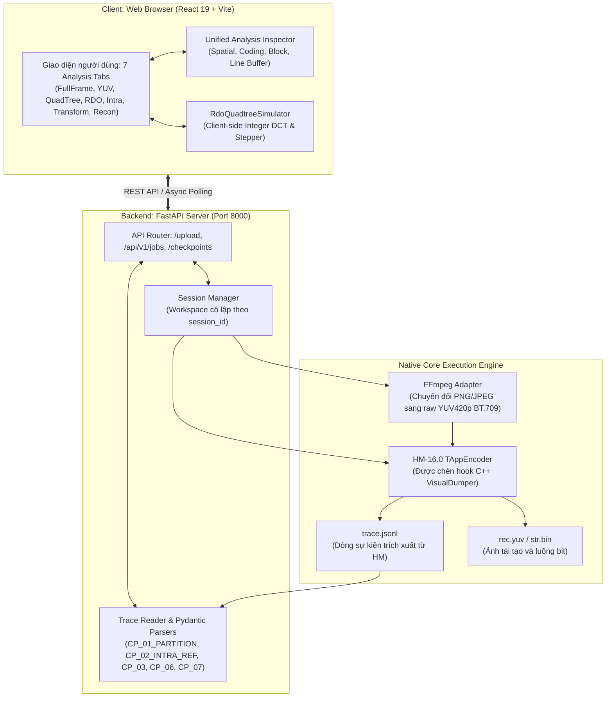

# 07. Kiến Trúc Toàn Diện Hệ Thống Web App (Full-Stack Architecture & Telemetry)

> [!NOTE]
> Tài liệu kỹ thuật tổng hợp toàn bộ kiến trúc hệ thống của ứng dụng **HEVC Video Analyzer**, bao gồm **FastAPI Backend (Python 3.12)** giao tiếp với bộ mã hóa C++ HM-16.0 instrumented, hệ thống trích xuất Checkpoints thời gian thực, và giao diện **React 19 + Vite Frontend** với 7 phân hệ phân tích chuyên sâu.
> 
> * **Thuộc bộ tài liệu:** [HEVC Documentation System](./README.md)
> * **Tài liệu trước:** [06. Cẩm Nang Phong Cách Kiến Trúc Tích Hợp HM](./06_HM_STYLE_GUIDE_FOR_WEB_APP.md)

---

## 📑 Mục lục
1. [Sơ đồ kiến trúc tổng thể toàn hệ thống](#1-sơ-đồ-kiến-trúc-tổng-thể-toàn-hệ-thống)
2. [Hệ thống Checkpoints & Pipeline dòng vết (Trace Stream)](#2-hệ-thống-checkpoints--pipeline-dòng-vết-trace-stream)
3. [Kiến trúc Backend: FastAPI & Quản lý phiên làm việc](#3-kiến-trúc-backend-fastapi--quản-lý-phiên-làm-việc)
4. [Kiến trúc Frontend: React 19 & 7 phân hệ Workspace](#4-kiến-trúc-frontend-react-19--7-phân-hệ-workspace)
5. [Quy trình kiểm thử & Vận hành (Testing & Deployment)](#5-quy-trình-kiểm-thử--vận-hành-testing--deployment)

---

## 1. Sơ đồ kiến trúc tổng thể toàn hệ thống

Hệ thống hoạt động theo mô hình **Khách - Chủ tách rời (Decoupled Client-Server)**, trong đó Backend đóng vai trò cầu nối điều phối giữa Web Browser và nhân tính toán C++ của bộ mã hóa tham chiếu HM-16.0:



---

## 2. Hệ thống Checkpoints & Pipeline dòng vết (Trace Stream)

Trong tệp mã nguồn C++ [`VisualDumper.cpp`](file:///home/hoinguyen/Documents/Video_Compression/HEVC_reference_software/source/Lib/TLibCommon/VisualDumper.cpp), các điểm cắm hook (Instrumentation Points) được thiết lập tại các vị trí quyết định để ghi nhận dữ liệu dưới dạng JSON Lines (`trace.jsonl`):

| Mã Checkpoint | Vị trí chèn hook trong C++ | Dữ liệu trích xuất | Mục đích trên Giao diện |
| :--- | :--- | :--- | :--- |
| **`CP_01_PARTITION`** | [`TEncCu::compressCtu`](file:///home/hoinguyen/Documents/Video_Compression/HEVC_reference_software/source/Lib/TLibEncoder/TEncCu.cpp#L251) | Cây đệ quy QuadTree phân tách CTU thành các lá CU ($64\to 8$), tọa độ, độ sâu. | Vẽ bản đồ phân vùng trên `FullFrameViewer` và cây cây Quadtree `QuadTreeVisualizer`. |
| **`CP_02_INTRA_REF`** | [`TEncSearch::estIntraPredLumaQT`](file:///home/hoinguyen/Documents/Video_Compression/HEVC_reference_software/source/Lib/TLibEncoder/TEncSearch.cpp#L2290) | Mảng $4N+1$ mẫu viền tham chiếu thô (Unfiltered) và mẫu qua lọc (Filtered), cờ SIS. | Hiển thị chu vi tham chiếu và nút gạt so sánh bộ lọc MDIS trên `IntraPredictionFlow`. |
| **`CP_03_INTRA_SEARCH`**| [`TEncSearch::estIntraPredLumaQT`](file:///home/hoinguyen/Documents/Video_Compression/HEVC_reference_software/source/Lib/TLibEncoder/TEncSearch.cpp#L2359) | Bảng đánh giá chi phí RDO cho 35 chế độ Intra, ma trận dự đoán $P$ và phần dư $R$. | La bàn góc 360° `AngularCompass` và đồ thị chi phí `CandidateModesTable`. |
| **`CP_05_RDO_DECISION`**| [`TEncCu::xCompressCU`](file:///home/hoinguyen/Documents/Video_Compression/HEVC_reference_software/source/Lib/TLibEncoder/TEncCu.cpp#L1179) | Chi phí $J_{\text{nosplit}}$ vs $J_{\text{split}}$, số bit, độ méo, cờ quyết định chia. | Thẻ đối đầu RDO `RdoDecisionCard` trong bộ mô phỏng. |
| **`CP_06_TRANSFORM`** | [`TComTrQuant::transformNxN`](file:///home/hoinguyen/Documents/Video_Compression/HEVC_reference_software/source/Lib/TLibCommon/TComTrQuant.cpp#L1532) | Ma trận phổ tần số 2D sau DCT-II / DST-VII, tỷ lệ gom năng lượng (Energy Compaction). | Ma trận nhiệt phổ tần số `TransformQuantVisualizer`. |
| **`CP_07_QUANT`** | [`TComTrQuant::transformNxN`](file:///home/hoinguyen/Documents/Video_Compression/HEVC_reference_software/source/Lib/TLibCommon/TComTrQuant.cpp#L1532) | Ma trận hệ số lượng tử hóa nguyên, tỷ lệ thưa (sparsity), cờ `CBF` (0 hoặc 1). | Trực quan hóa ma trận lượng tử và cờ phần dư `CBF`. |
| **`CP_08_RECON_FILTER`**| [`TEncCu::xCompressCU`](file:///home/hoinguyen/Documents/Video_Compression/HEVC_reference_software/source/Lib/TLibEncoder/TEncCu.cpp#L1188) | Ma trận điểm ảnh tái tạo $\hat{S} = P + \hat{R}$, ảnh trước và sau lọc Deblocking. | Kính hiển vi so sánh 4 ảnh `FourPictureComparison` và `Synchronized4WayViewport`. |

---

## 3. Kiến trúc Backend: FastAPI & Quản lý phiên làm việc

* **Mã nguồn:** Thư mục [`web_app/backend`](file:///home/hoinguyen/Documents/Video_Compression/HEVC_reference_software/web_app/backend/).
* **Ngôn ngữ:** Python 3.12 + FastAPI + Pydantic v2 + Uvicorn.
* **Quy trình xử lý Job bất đồng bộ:**
  1. Người dùng gửi ảnh qua `POST /upload` kèm tham số tọa độ `ctu_x`, `ctu_y`, `cu_size`.
  2. Backend sinh `job_id`, khởi tạo thư mục cô lập `workspace/sessions/{job_id}/`.
  3. `FFmpegAdapter` chuyển đổi ảnh thành `input.yuv` (chuẩn màu BT.709 full range).
  4. `HMEncoderRunner` thiết lập biến môi trường `VISUAL_CTU_X`, `VISUAL_CTU_Y`, gọi `TAppEncoder` chạy ngầm.
  5. `TraceReader` đọc luồng `trace.jsonl`, bóc tách thành các Pydantic models trả về Client qua endpoint `/api/v1/checkpoints/{job_id}/{checkpoint_id}`.

---

## 4. Kiến trúc Frontend: React 19 & 7 phân hệ Workspace

* **Mã nguồn:** Thư mục [`web_app/frontend`](file:///home/hoinguyen/Documents/Video_Compression/HEVC_reference_software/web_app/frontend/).
* **Công nghệ:** React 19, Vite, Oxlint, Lucide Icons, Canvas API, SVG Native.
* **7 Phân hệ chức năng chính:**
  1. **Tab 1: Frame (`FullFrameViewer`)**: Hiển thị ảnh gốc, phủ lưới 64×64 CTU, xử lý biên ảnh (`bBoundary` Forced Split), chuyển nhanh chế độ xem bằng phím tắt `T`.
  2. **Tab 2: YUV Planes (`YUVViewer`)**: Phân tách 3 kênh $Y, Cb, Cr$ với các bộ lọc hiển thị: Grayscale, Channel Tint, Turbo Heatmap.
  3. **Tab 3: QuadTree (`QuadTreeVisualizer`)**: Cây phân cấp QuadTree duyệt theo Z-scan (Depth 0 đến 3), hiển thị chi tiết từng khối lá.
  4. **Tab 4: RDO Simulator (`RdoQuadtreeSimulator`)**: Bộ mô phỏng thuật toán đệ quy `xCompressCU` chạy thuần túy trên trình duyệt với Integer DCT, điều khiển bước Step-by-Step, thanh trượt $QP$ và $\lambda$.
  5. **Tab 5: Intra Prediction (`IntraPredictionFlow`)**: Khảo sát 35 chế độ dự đoán, la bàn góc tương tác `AngularCompass`, mảng viền $4N+1$ mẫu, danh sách 3 MPM.
  6. **Tab 6: Transform & Quant (`TransformQuantVisualizer`)**: Kiểm tra phổ tần số DCT/DST, ma trận lượng tử hóa và cờ `CBF`.
  7. **Tab 7: Reconstruction (`FourPictureComparison` & `Synchronized4WayViewport`)**: Kính lúp Pixel Microscope đồng bộ con trỏ crosshair trên cả 4 ảnh: Gốc, Dự đoán, Phần dư, Tái tạo.

---

## 5. Quy trình kiểm thử & Vận hành (Testing & Deployment)

Toàn bộ hệ thống được bảo vệ bởi bộ kiểm thử tự động với độ bao phủ cao:

### A. Kiểm thử Backend (Python / Pytest):
```bash
cd /home/hoinguyen/Documents/Video_Compression/HEVC_reference_software/web_app/backend
source venv/bin/activate
pytest -v
```
* **29 unit & integration tests** đảm bảo tính toàn vẹn của Pydantic parser, FFmpeg adapter, Session manager và kết nối với bộ mã hóa thật HM-16.0.

### B. Kiểm thử & Linting Frontend (React / Oxlint / Vitest):
```bash
cd /home/hoinguyen/Documents/Video_Compression/HEVC_reference_software/web_app/frontend
npm run lint    # Kiểm tra chuẩn mã nguồn siêu tốc với oxlint
npm test        # 187 automated unit tests kiểm tra toàn bộ luồng xử lý UI
npm run build   # Đóng gói bundle tối ưu hóa vào thư mục dist/
```

### C. Khởi động nhanh toàn bộ hệ thống:
```bash
# Tại thư mục gốc:
cd /home/hoinguyen/Documents/Video_Compression/HEVC_reference_software/web_app
./run_tool.sh
```
* Backend mở tại: `http://localhost:8000` (Tài liệu API Swagger tại `/docs`).
* Frontend mở tại: `http://localhost:5173`.

