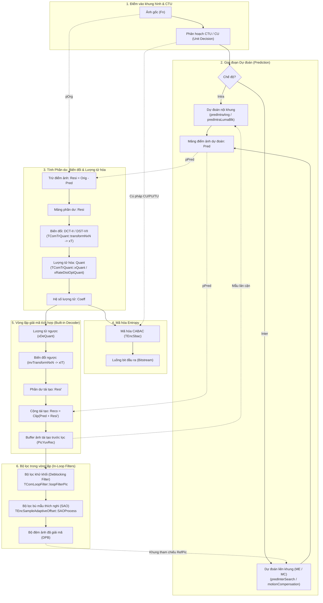

# Phân Tích Luồng Mã Hóa Xử Lý Theo Khối (Block-Based Hybrid Encoding) trong HM-18.0

> Mô hình mã hóa lai ghép dựa trên khối (**Block-based Hybrid Video Coding**) theo chuẩn ITU-T H.265 / HEVC và cách hiện thực hóa trong [`TLibCommon`](../source/Lib/TLibCommon) & [`TLibEncoder`](../source/Lib/TLibEncoder).

---

## 1. Sơ đồ Khối Tổng quan HEVC Hybrid Encoder

---

## 2. Truy vết Dòng chảy Dữ liệu Điểm ảnh Mảng 2D (`Pel*`)

1. **Dự đoán (`Pred`):**
   - **Intra** ([`TComPrediction::predIntraAng`](../source/Lib/TLibCommon/TComPrediction.cpp#L390)): Trích $4N+1$ mẫu biên từ `getPicYuvRec()`, lọc tham chiếu qua `initIntraPatternChType()` (3-tap $[1, 2, 1]/4$ hoặc Strong Intra Smoothing) và nội suy theo mode `0..34` vào con trỏ `Pel* piPred`.
   - **Inter** ([`TComPrediction::motionCompensation`](../source/Lib/TLibCommon/TComPrediction.cpp#L905)): Sau khi [`xMotionEstimation()`](../source/Lib/TLibEncoder/TEncSearch.cpp#L3300) tìm được vector chuyển động $MV = (dx, dy)$, lọc nội suy phân số 8-tap (Luma) / 4-tap (Chroma) từ khung tham chiếu DPB vào `pcPredYuv`.
2. **Phần dư, Biến đổi & Lượng tử hóa (`Resi` $\to$ `Coeff`):**
   - **Trừ phần dư** ([`xIntraCodingTUBlock`](../source/Lib/TLibEncoder/TEncSearch.cpp#L1252-L1262) / [`xEstimateInterResidualQT`](../source/Lib/TLibEncoder/TEncSearch.cpp#L4870)): `pResi[x] = pOrg[x] - pPred[x]`.
   - **Biến đổi thuận** ([`TComTrQuant::transformNxN`](../source/Lib/TLibCommon/TComTrQuant.cpp#L1452) $\to$ [`xT`](../source/Lib/TLibCommon/TComTrQuant.cpp#L1512)): Dùng **DST-VII** cho khối Luma Intra $4\times 4$; dùng **DCT-II** cho mọi kích thước còn lại ($4\times 4$ đến $32\times 32$).
   - **Lượng tử hóa** ([`xQuant`](../source/Lib/TLibCommon/TComTrQuant.cpp#L1520) / [`xRateDistOptQuant`](../source/Lib/TLibCommon/TComTrQuant.cpp#L789)): $\text{Level} = \text{sign}(C) \cdot \lfloor (|C| \cdot Q_{\text{scale}} + f) / 2^{q\_\text{bits}} \rfloor$. Nếu tổng trị tuyệt đối `uiAbsSum > 0`, bật cờ `Cbf = 1`.
3. **Giải mã nội bộ & Tái tạo (`Resi'` $\to$ `Reco`):**
   - **Lượng tử ngược & Biến đổi ngược** ([`invTransformNxN`](../source/Lib/TLibCommon/TComTrQuant.cpp#L1555) $\to$ [`xDeQuant`](../source/Lib/TLibCommon/TComTrQuant.cpp#L1626) $\to$ [`xIT`](../source/Lib/TLibCommon/TComTrQuant.cpp#L1646)): Khôi phục phần dư $Resi'$.
   - **Cộng tái tạo & Clip:** `pReco[x] = ClipBD(pPred[x] + pResi[x], bitDepth)`. Với Intra, mẫu tái tạo được ghi ngay vào `PicYuvRec` theo thứ tự Z-scan để làm mẫu tham chiếu biên cho các TU kế tiếp.
4. **Lọc trong vòng lặp (`DBF` $\to$ `SAO` $\to$ `DPB`):**
   - **Deblocking** ([`TComLoopFilter::loopFilterPic`](../source/Lib/TLibCommon/TComLoopFilter.cpp#L130)): Tính $BS \in \{0, 1, 2\}$ tại biên khối $8\times 8$, lọc toàn bộ biên dọc trước rồi biên ngang sau.
   - **SAO** ([`TEncSampleAdaptiveOffset::SAOProcess`](../source/Lib/TLibEncoder/TEncSampleAdaptiveOffset.cpp#L240)): Tối ưu RDO chọn Edge Offset (EO), Band Offset (BO) hoặc OFF cho từng CTU và cộng bù `offsetBlock()` trước khi đưa ảnh vào DPB.

---

## 3. Đối chiếu Xử lý Điểm ảnh (Block / `Pel*`) vs Cú pháp Điều khiển (Unit / `TComDataCU`)

| Giai đoạn mã hóa | Hàm / Khối mã nguồn | Phân loại | Bản chất dữ liệu thao tác |
| :--- | :--- | :---: | :--- |
| **Phân hoạch CTU/CU** | [`TEncCu::xCompressCU`](../source/Lib/TLibEncoder/TEncCu.cpp#L531) | **UNIT** | Điều khiển cây Quadtree, gán `m_puhDepth`, so sánh chi phí $J = D + \lambda R$. |
| **Thiết lập chế độ PU** | `setPartSizeSubParts`, `setPredModeSubParts` | **UNIT** | Gán `PartSize` và `PredMode` (`INTER`/`INTRA`) vào mảng 1D của `TComDataCU`. |
| **Intra Prediction** | [`TComPrediction::predIntraAng`](../source/Lib/TLibCommon/TComPrediction.cpp#L390) | **BLOCK** | Nội suy góc từ $4N+1$ mẫu biên tạo mảng 2D điểm ảnh dự đoán `piPred`. |
| **Inter Motion Search** | [`TEncSearch::predInterSearch`](../source/Lib/TLibEncoder/TEncSearch.cpp#L3057) | **UNIT** | Duyệt `iPartIdx`, chọn AMVP/Merge candidate, Reference index và MV tối ưu. |
| **Motion Compensation** | [`TComPrediction::motionCompensation`](../source/Lib/TLibCommon/TComPrediction.cpp#L905) | **BLOCK** | Lọc nội suy 8-tap/4-tap trên mảng điểm ảnh tham chiếu sinh `pcPredYuv`. |
| **Transform & Quant** | [`TComTrQuant::xT`](../source/Lib/TLibCommon/TComTrQuant.cpp#L1512) · [`xQuant`](../source/Lib/TLibCommon/TComTrQuant.cpp#L1520) | **BLOCK** | Nhân ma trận DST-VII/DCT-II trên `Pel*` và lượng tử hóa trên `TCoeff*`. |
| **RQT Tree Control** | [`xEstimateInterResidualQT`](../source/Lib/TLibEncoder/TEncSearch.cpp#L4838) | **UNIT** | Quyết định chia cây TU, quản lý độ sâu `m_puhTrIdx` và cờ `m_puhCbf`. |
| **IQ, IT & Recon** | [`xDeQuant`](../source/Lib/TLibCommon/TComTrQuant.cpp#L1626) · [`xIT`](../source/Lib/TLibCommon/TComTrQuant.cpp#L1646) · [`addClip`](../source/Lib/TLibCommon/TComYuv.cpp#L282) | **BLOCK** | Khôi phục phần dư `Pel*` và cộng clip với `Pred` ghi vào `PicYuvRec`. |
| **Deblocking & SAO** | [`xGetBoundaryStrengthSingle`](../source/Lib/TLibCommon/TComLoopFilter.cpp#L416) / [`offsetBlock`](../source/Lib/TLibCommon/TComSampleAdaptiveOffset.cpp#L313) | **UNIT + BLOCK** | Phân tích cờ cú pháp (`BS`, `EO/BO` mode) rồi lọc/cộng bù trực tiếp trên `Pel*`. |
| **Entropy Coding** | [`TEncSbac::codeCoeffNxN`](../source/Lib/TLibEncoder/TEncSbac.cpp#L1070) | **UNIT** | Mã hóa nhị phân CABAC các cờ cú pháp và hệ số khác 0 thành bitstream. |
